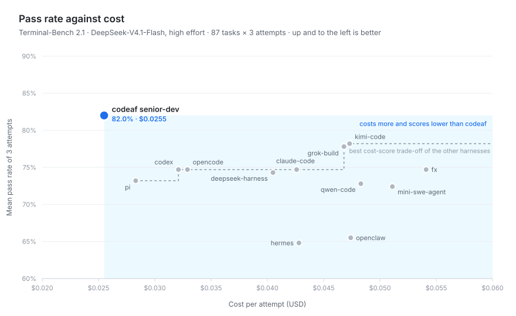

# Harness benchmarks

These are benchmark runs of codeaf's agents. Each run is set up and scored to compare directly
with a published harness leaderboard. Each folder holds one benchmark: what was run and how, the
results of every attempt, and the scripts that recompute every number.

| Benchmark | Agent | Model | Rank | Pass rate (mean of 3) | Cost per attempt |
|---|---|---|---:|---:|---:|
| [Terminal-Bench 2.1](terminal-bench-2.1) | codeaf senior-dev | DeepSeek-V4.1-Flash, high effort | 1 of 13 | 82.0% | $0.026 |

<picture>
  <source media="(prefers-color-scheme: dark)" srcset="terminal-bench-2.1/results/charts/cost-vs-score-dark.svg">
  
</picture>
