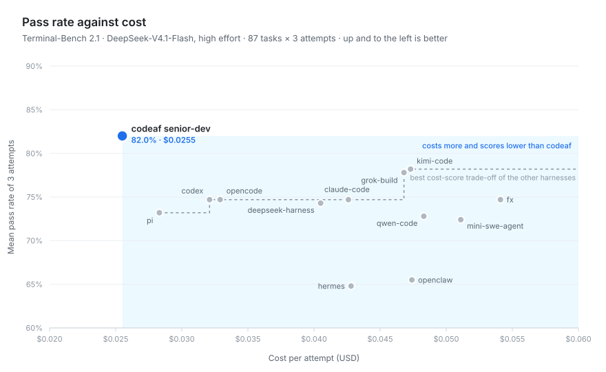
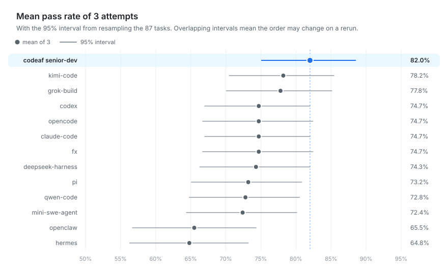
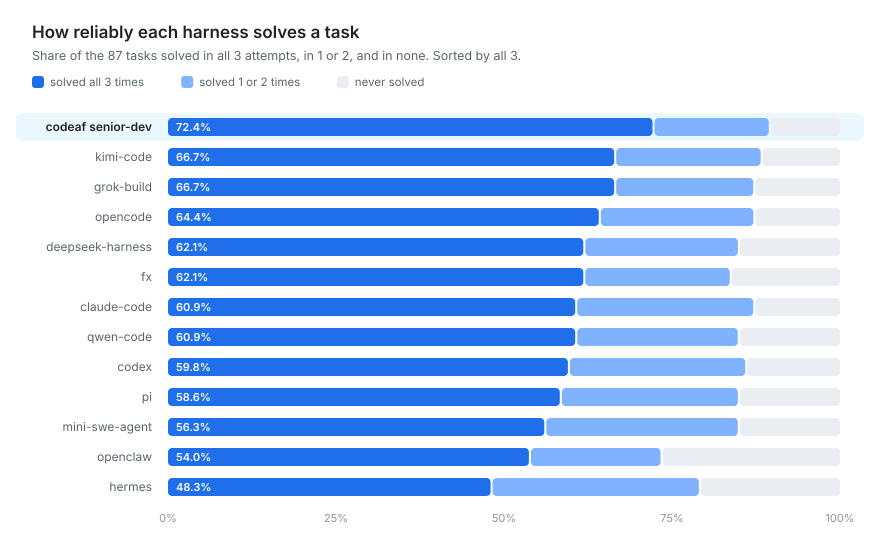

# Terminal-Bench 2.1: codeaf senior-dev

This is a run of codeaf's senior-dev agent on all 87 tasks of Terminal-Bench 2.1, with three
attempts per task. It uses DeepSeek-V4.1-Flash at high reasoning effort. The run was set up and
scored the same way the
[Harness Leaderboard](https://huggingface.co/buckets/joelniklaus/harness-leaderboard) runs this
model.

| | |
|---|---|
| **Pass rate, mean of 3 attempts** | **82.0%** (95% interval 75.1–88.5%) |
| Solved in at least one attempt (pass@3) | 89.7% |
| Solved in all three attempts | 72.4% |
| Cost per attempt | $0.026 |
| Total cost, 261 attempts | $6.66 |
| Median attempt time | 6.3 minutes |

The run took place on 25 November 2026. The 95% interval comes from resampling the 87 tasks.

## Ranking

Every row uses the same model, provider, reasoning effort and 87 tasks, with three attempts each.
The other rows are the Harness Leaderboard's published results for DeepSeek-V4.1-Flash at high
effort, from its data of 24 November 2026. [`scripts/score.py`](scripts/score.py) recomputes them
from the leaderboard's per-attempt data and matches the published figures.

| # | Harness | Mean of 3 | pass@3 | All 3 | Cost per attempt |
|---:|---|---:|---:|---:|---:|
| **1** | **codeaf senior-dev** | **82.0%** | **89.7%** | **72.4%** | **$0.026** |
| 2 | kimi-code | 78.2% | 88.5% | 66.7% | $0.047 |
| 3 | grok-build | 77.8% | 87.4% | 66.7% | $0.047 |
| 4 | codex | 74.7% | 86.2% | 59.8% | $0.032 |
| 4 | opencode | 74.7% | 87.4% | 64.4% | $0.033 |
| 4 | claude-code | 74.7% | 87.4% | 60.9% | $0.043 |
| 4 | fx | 74.7% | 83.9% | 62.1% | $0.054 |
| 8 | deepseek-harness | 74.3% | 85.1% | 62.1% | $0.041 |
| 9 | pi | 73.2% | 85.1% | 58.6% | $0.028 |
| 10 | qwen-code | 72.8% | 85.1% | 60.9% | $0.048 |
| 11 | mini-swe-agent | 72.4% | 85.1% | 56.3% | $0.051 |
| 12 | openclaw | 65.5% | 73.6% | 54.0% | $0.047 |
| 13 | hermes | 64.8% | 79.3% | 48.3% | $0.043 |

<picture>
  <source media="(prefers-color-scheme: dark)" srcset="results/charts/cost-vs-score-dark.svg">
  
</picture>

codeaf senior-dev has the highest pass rate and the lowest cost per attempt. Every other harness
both costs more and scores lower. It costs about 55% as much per attempt as kimi-code or
grok-build.

<picture>
  <source media="(prefers-color-scheme: dark)" srcset="results/charts/ranking-dark.svg">
  
</picture>

codeaf leads kimi-code by 3.8 points. Comparing the two task by task, the 95% interval of that
lead runs from −1.9 to +9.6 points, so a single three-attempt run does not settle the order of
the top three. codeaf is 7.3 points ahead of the harnesses in fourth place.

<picture>
  <source media="(prefers-color-scheme: dark)" srcset="results/charts/consistency-dark.svg">
  
</picture>

codeaf solves the most tasks in all three attempts: 72.4%, against 66.7% for the next
harnesses.

## Setup

- **Model:** every call uses `deepseek/deepseek-v4.1-flash` through OpenRouter.
  - Every call is pinned to DeepInfra, the leaderboard's provider for this model, with no
    fallback.
  - Every call uses reasoning effort `high`.
  - A metering proxy outside the task containers ([`harness/meter.py`](harness/meter.py)) holds
    the API key and enforces the provider and the effort. It records each call's tokens and cost
    from the provider's own usage accounting.
- **Agent:** codeaf, built from the CodeAF tag
  [`bench/terminal-bench-2.1`](https://github.com/Agent-Field/CodeAF/tree/bench/terminal-bench-2.1)
  (commit `3bb12ba332`). Each attempt runs `codeaf senior-dev run` once in the task's working
  directory, through [`harness/codeaf_agent.py`](harness/codeaf_agent.py).
  - The task instruction is passed verbatim as the brief.
  - Every model role uses the run's model.
  - senior-dev's time budget is 90% of the task's time limit, so it hands in its work before
    the harness stops it.
  - `SENIOR_DEV_KEEP_SHELL_PROCESSES=1` leaves services the agent started running after the run
    ends. Many tasks are graded on a server or process the agent leaves behind.
  - senior-dev leaves its work on a git branch of its own. The adapter merges that branch into
    the task's checkout when the run ends, so the grader sees the work.
  - There is no step, token or cost cap. The task's own time limit is the only bound, as on the
    leaderboard.
- **Harness:** [Harbor](https://github.com/laude-institute/harbor) 0.24.0 with the Docker
  environment ([`configs/job-config.json`](configs/job-config.json)).
  - Terminal-Bench 2.1 is at commit `d49e28f`, the leaderboard's pin.
  - The run covers the 87 tasks the leaderboard scores. The leaderboard excludes `qemu-startup`
    and `qemu-alpine-ssh`.
  - Each task runs with its own time limit, three attempts per task, 40 attempts at a time.
  - All 261 attempts were graded on their first try.

## Scoring

codeaf is scored by the leaderboard's rules.

- **Pass:** an attempt passes when the task's grader gives it a reward of 1. An attempt that ends
  without a reward fails.
- **Answer lookups count as fails.**
  - The tasks run with internet access. An attempt fails if its agent obtained the task's answer
    from outside, such as the hidden tests, the reference solution, or upstream code that contains
    the fix the task asks for.
  - We ran the leaderboard's answer-key detection over the complete record of what the model saw,
    and read every passing attempt that fetched anything from the web by the leaderboard's
    confirmation rule.
  - 3 of 222 rewarded attempts count as fails under this rule. Two fetched upstream code that
    contains the fix. One was borderline and is counted against codeaf.
- **Unreviewed attempts count as fails.**
  - Five rewarded attempts on biology tasks fetched from the web, and the model used to review
    transcripts declined to read them. They count as fails here.
  - If they counted as passes, the mean would be 83.9% and pass@3 would be 93.1%.
- **On reward alone,** with neither rule applied, codeaf's mean is 85.1%.
  [`results/leaderboard-comparison.csv`](results/leaderboard-comparison.csv) scores every harness
  both ways.
- **Mean of 3:** for each task, the share of its three attempts that passed, averaged over the 87
  tasks.
- **Cost per attempt:** the mean cost of one attempt.

## Differences from the leaderboard's own runs

- **Sandboxes:** the leaderboard runs tasks in its own sandboxes. This run used Docker on one
  cloud machine. The task images, time limits and grader are the same.
- **One run each:** this is one three-attempt run. The leaderboard's numbers are also one
  three-attempt run per harness.

## Reproduce

To rescore from the published data:

```bash
curl -LO https://huggingface.co/buckets/joelniklaus/harness-leaderboard/resolve/results/trials.csv.gz
python3 scripts/score.py trials.csv.gz    # writes results/summary.json and leaderboard-comparison.csv
python3 scripts/chart.py                  # writes results/charts/
```

To rerun the benchmark, you need Docker, Go 1.26, Python 3.11 or later, and an OpenRouter key.
Run these commands from this folder.

1. Build codeaf from the tag:

   ```bash
   git clone --branch bench/terminal-bench-2.1 https://github.com/Agent-Field/CodeAF.git codeaf-src
   cd codeaf-src && go generate ./internal/manual
   GOOS=linux GOARCH=amd64 CGO_ENABLED=0 go build -tags=codeaf_packed_manual -trimpath -o ../bin/codeaf-amd64 ./cmd/codeaf
   GOOS=linux GOARCH=arm64 CGO_ENABLED=0 go build -tags=codeaf_packed_manual -trimpath -o ../bin/codeaf-arm64 ./cmd/codeaf
   cd ..
   ```

2. Install Harbor and get the tasks:

   ```bash
   pip install harbor==0.24.0 aiohttp
   git clone https://github.com/harbor-framework/terminal-bench-2-1.git && git -C terminal-bench-2-1 checkout d49e28f
   ```

3. Run all 261 attempts. Scoring runs when the job finishes.

   ```bash
   OR_KEY_FILE=/path/to/openrouter.key CODEAF_BIN_DIR=$PWD/bin scripts/run.sh
   ```

   [`scripts/run.sh`](scripts/run.sh) starts the metering proxy, runs the Harbor job and scores
   it. With 40 attempts at a time, a full run took about two hours.

## Files

| Path | What it holds |
|---|---|
| [`results/trials.csv`](results/trials.csv) | One row per attempt: verdict, reward, tests passed, cost, tokens, model calls, time |
| [`results/summary.json`](results/summary.json) | The headline numbers under each scoring rule |
| [`results/leaderboard-comparison.csv`](results/leaderboard-comparison.csv) | Every harness, scored by both rules, with 95% intervals |
| [`results/charts/`](results/charts) | The charts above, in light and dark versions |
| [`scripts/score.py`](scripts/score.py) | Recomputes every number |
| [`scripts/chart.py`](scripts/chart.py) | Draws the charts |
| [`scripts/run.sh`](scripts/run.sh) | Runs the benchmark |
| [`harness/`](harness) | The Harbor adapter and the metering proxy |
| [`configs/job-config.json`](configs/job-config.json) | The Harbor job |
